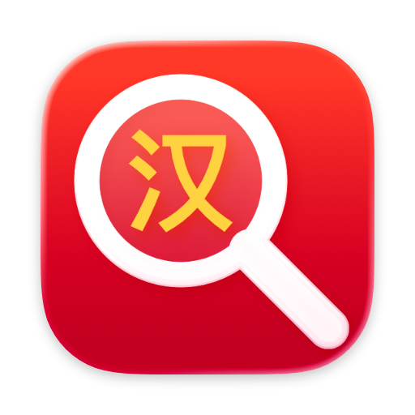
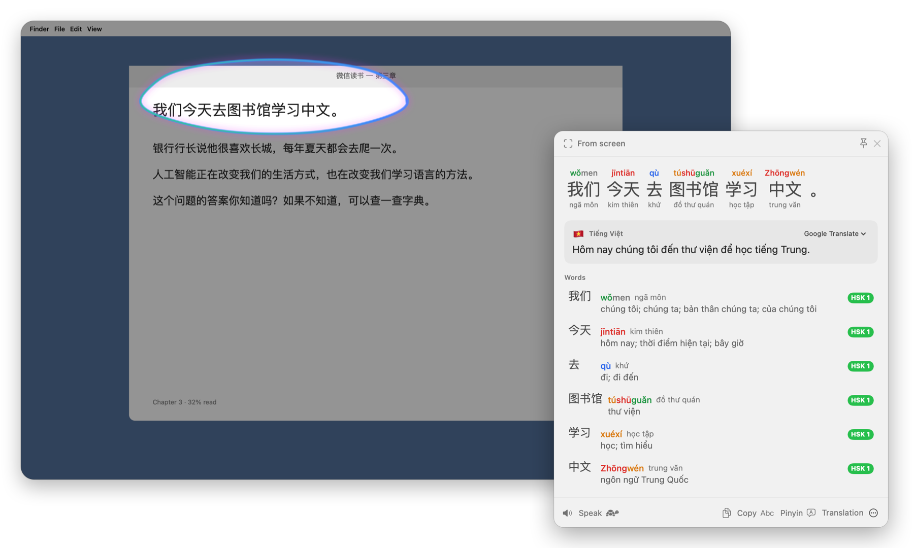
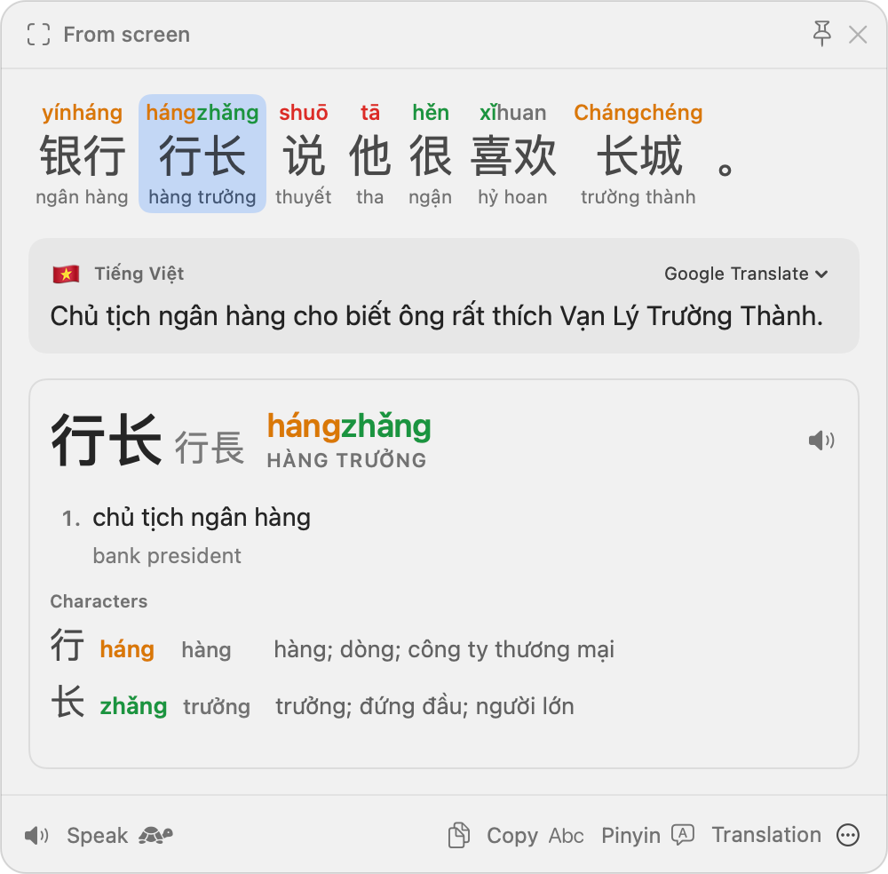
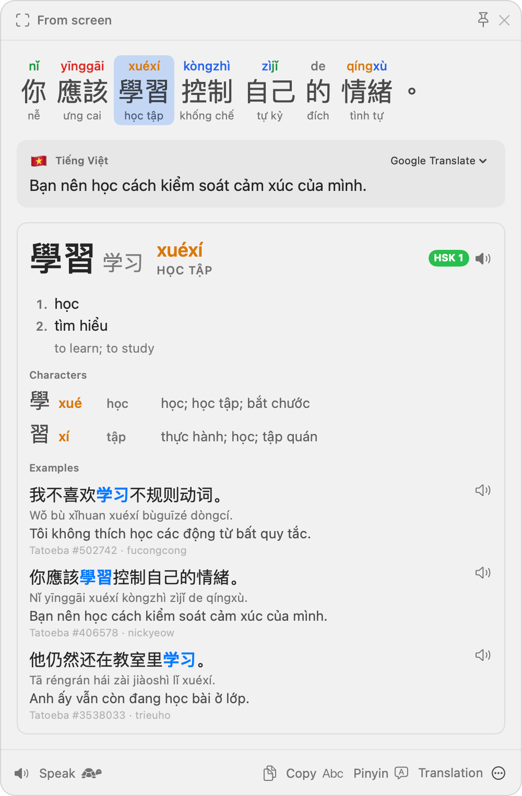

<div align="center">



# HanLens

**Circle any Chinese on your screen — get pinyin, Hán Việt and Vietnamese in a second.**<br>
<sub>Khoanh chữ Hán bất kỳ trên màn hình — có ngay pinyin, âm Hán Việt và nghĩa tiếng Việt.</sub>

<br>

[](https://github.com/an6122003/chinese-ocr-translate/releases/latest)
&nbsp;
[](#-windows-version)

[](https://github.com/an6122003/chinese-ocr-translate/releases/latest)


<br>



</div>

<br>

## ✨ Why HanLens

<table>
<tr>
<td width="33%" valign="top">

### 🔎 Circle to search
Press <kbd>⌃</kbd><kbd>⌥</kbd><kbd>S</kbd>, then drag a box, draw a circle or click a highlighted line. It reads text you **can't select** — images, videos, PDFs, games, screen shares.

</td>
<td width="33%" valign="top">

### 🈶 Readings you can trust
Pinyin is chosen from context — 银行 *yínháng* but 行长 *hángzhǎng* — with tone colours, neutral tones and erhua. Every word gets its **Hán Việt** reading, checked against Thiều Chửu.

</td>
<td width="33%" valign="top">

### 🇻🇳 Vietnamese first
An **offline** Vietnamese dictionary (CVDICT, ~122,000 entries) plus English, and a full-sentence translation from Google or Apple's private on-device engine.

</td>
</tr>
<tr>
<td width="33%" valign="top">

### 🎬 Follow subtitles
Capture a subtitle once and press **Follow** — the panel keeps reading that spot and updates every time the line changes.

</td>
<td width="33%" valign="top">

### 🗣️ Natural Mandarin voices
Hear any sentence in Microsoft's 晓晓 / 云希 or ElevenLabs' native Mandarin voices, with the word being spoken lit up karaoke-style. Slow mode included.

</td>
<td width="33%" valign="top">

### 📚 Learn as you go
HSK levels, a breakdown of every character, 65,000 real example sentences, and a searchable history you can export to **Anki**.

</td>
</tr>
</table>

## 📸 A closer look

<table>
<tr>
<td align="center" width="50%" valign="top">
<picture>
  <source media="(prefers-color-scheme: dark)" srcset="macos/docs/images/panel-readings-dark.png">
  
</picture>
<br>
<sub><b>Context-aware readings.</b> 行 is <i>háng</i> in 银行 and 行长 — HanLens gets it right, and shows hàng trưởng in Hán Việt.</sub>
</td>
<td align="center" width="50%" valign="top">
<picture>
  <source media="(prefers-color-scheme: dark)" srcset="macos/docs/images/panel-word-detail-dark.png">
  
</picture>
<br>
<sub><b>Every word explained.</b> Meanings, characters, HSK level and real example sentences — simplified or traditional.</sub>
</td>
</tr>
</table>

## ⬇️ Install

1. **[Download HanLens](https://github.com/an6122003/chinese-ocr-translate/releases/latest)** — the `.dmg` file under *Assets*.
2. Open it and drag **HanLens** onto **Applications**.
3. Open HanLens from your Applications folder.
4. The welcome window asks for two permissions:
   - **Screen Recording** — to read text on screen. Nothing is recorded or uploaded. Grant it, then click **Relaunch**.
   - **Accessibility** — to translate selected text and to type pinyin tones.

> [!IMPORTANT]
> **The first time, macOS refuses to open HanLens** because it isn't from the App Store or notarized by Apple yet.
> Click **Done**, open **System Settings › Privacy & Security**, scroll down and click **Open Anyway** next to HanLens.
> You only need to do this once.

> [!NOTE]
> HanLens needs **macOS 26 Tahoe** or later, on Apple Silicon or Intel.

## 🚀 How to use it

| | Do this | And |
|:-:|---|---|
| 🔎 | <kbd>⌃</kbd><kbd>⌥</kbd><kbd>S</kbd> | The screen freezes: drag a box, circle the text, or click a highlighted line. <kbd>↩</kbd> reads the whole screen, <kbd>esc</kbd> cancels. |
| ✍️ | <kbd>⌃</kbd><kbd>⌥</kbd><kbd>X</kbd> | Translates the text you've selected in any app. |
| 🔊 | <kbd>Space</kbd> | Reads the result aloud — 🐢 for slow. |
| 👆 | Click a word | Meanings, characters, Hán Việt, HSK level and examples. <kbd>←</kbd> <kbd>→</kbd> moves between words. |
| 🎬 | <kbd>⌘</kbd><kbd>F</kbd> | **Follow** the same spot on screen — perfect for video subtitles. |
| 📌 | Drag the panel | Pins it so it stays open while you read. <kbd>esc</kbd> closes it. |
| ⌨️ | Type `ni3hao3` | Becomes **nǐhǎo** in any app (turn on *Pinyin Tone Typing* in the menu). |

> [!TIP]
> Right-click HanLens in the Dock for **Look Up…**, **Look Up Clipboard**, **History** and **Settings**.
> Every shortcut can be changed in **Settings › Shortcuts**.

## 🗣️ Voices

Pick one in **Settings › Speech**. If a voice can't be reached, HanLens quietly falls back to the next one.

| Voice | What it sounds like | Cost | Setup |
|---|---|---|---|
| **Microsoft Azure** | 晓晓 Xiaoxiao, 云希 Yunxi… — the voices you hear in Chinese apps and videos | Free up to 500,000 characters a month | Paste a free Azure Speech key — the region is found for you |
| **ElevenLabs** | Native Mandarin voices from its library | Your ElevenLabs credits (about 1 per character) | **Sign in with ElevenLabs**, or paste an API key |
| **Google** | Clear but dated | Free | None — the default |
| **Apple** | Good with a *Premium* voice installed | Free, works offline | Optional voice download |

## 🔒 Privacy

- Text recognition, the dictionary and Hán Việt readings run **on your Mac**.
- Sentences go to Google Translate unless you choose Apple's on-device translation.
- Text you play aloud goes to the voice service you picked; replays come from a local cache.
- Keys and sign-ins are kept in your macOS Keychain. No analytics, no tracking.

<br>

<details>
<summary><b>🇻🇳 Hướng dẫn bằng tiếng Việt</b></summary>

<br>

**HanLens** giúp bạn đọc chữ Hán ở bất cứ đâu trên máy Mac: khoanh vùng chữ là có ngay pinyin, âm Hán Việt, nghĩa
tiếng Việt và câu ví dụ.

**Cài đặt**

1. Tải file `.dmg` ở trang [Releases](https://github.com/an6122003/chinese-ocr-translate/releases/latest) (mục *Assets*).
2. Mở file, kéo biểu tượng **HanLens** vào thư mục **Applications**.
3. Mở HanLens trong Applications. Lần đầu macOS sẽ chặn vì ứng dụng chưa được Apple xác minh: bấm **Done**, vào
   **System Settings › Privacy & Security**, kéo xuống và bấm **Open Anyway** cạnh HanLens. Chỉ cần làm một lần.
4. Cấp hai quyền trong cửa sổ chào mừng:
   - **Screen Recording** — để đọc chữ trên màn hình (không ghi hình, không gửi đi đâu), rồi bấm **Relaunch**.
   - **Accessibility** — để dịch đoạn chữ đang bôi đen và gõ dấu pinyin.

**Sử dụng**

- <kbd>⌃</kbd><kbd>⌥</kbd><kbd>S</kbd> (Control + Option + S): màn hình đứng lại — kéo khung, khoanh tròn hoặc bấm vào
  dòng chữ được tô sáng.
- <kbd>⌃</kbd><kbd>⌥</kbd><kbd>X</kbd>: dịch đoạn chữ bạn đang bôi đen trong bất kỳ ứng dụng nào.
- Trong bảng kết quả: <kbd>Space</kbd> để nghe đọc, bấm vào một từ để xem nghĩa, từng chữ, âm Hán Việt và câu ví dụ;
  <kbd>esc</kbd> để đóng.
- Xem phim có phụ đề: khoanh dòng phụ đề rồi bấm **Follow** (<kbd>⌘</kbd><kbd>F</kbd>) — bảng tự cập nhật khi phụ đề đổi.
- Muốn giọng đọc tự nhiên hơn: vào **Settings › Speech** (Microsoft Azure miễn phí 500.000 ký tự mỗi tháng, hoặc đăng
  nhập ElevenLabs).

Cần macOS 26 (Tahoe) trở lên.

</details>

<details>
<summary><b>🛠️ Build it yourself</b></summary>

<br>

You need macOS 26, Xcode 26, [XcodeGen](https://github.com/yonaskolb/XcodeGen) (`brew install xcodegen`) and Python 3.

```bash
cd macos
make install   # fetch & build the dictionary, build, sign, install to /Applications and launch
make test      # 68 unit tests
make dmg       # a shareable build/HanLens-<version>.dmg
```

How it's put together, the data pipeline, automation URLs (`hanlens://capture`, `hanlens://lookup?text=学习`…) and
troubleshooting: **[macos/README.md](macos/README.md)**.

</details>

<br>

## 🪟 Windows version

The project started as **Pinyin Input & Chinese Dictionary**, a lightweight Windows background utility — still here
in this repository's root folder.

- **Pinyin tone typing** in any app — type `ma`, press `1` → `mā` (`lv3` → `lǚ`).
- **Highlight & translate** with <kbd>Alt</kbd>+<kbd>X</kbd> — pinyin, Vietnamese translation and a word breakdown.
- **OCR capture** with <kbd>Alt</kbd>+<kbd>S</kbd> — drag over any Chinese text, then copy it or translate it. Uses
  Windows' built-in OCR.

<details>
<summary><b>Set up and run the Windows version</b></summary>

<br>

**Requirements:** Windows 10/11, Python 3, and the Chinese OCR language pack (detected automatically).

```bash
pip install -r requirements.txt
```

or `pip install pynput pystray Pillow pypinyin deep_translator jieba pyperclip winocr mss`.

**Run it:** double-click `run_pinyin.bat`, or run `python app.py`.

1. **Type pinyin** — e.g. `ma`, then press `1`–`4` for the tone: `na2` → `ná`, `na3` → `nǎ`, `bu4` → `bù`, `lv3` → `lǚ`.
2. **Translate** — highlight Chinese text and press <kbd>Alt</kbd>+<kbd>X</kbd>.
3. **OCR** — press <kbd>Alt</kbd>+<kbd>S</kbd>, drag over text, then choose **Copy Text** or **Translate**.

The hotkeys can be changed in Settings.

**If OCR finds no Chinese text,** install the language pack (PowerShell as Administrator):

```powershell
Add-WindowsCapability -Online -Name "Language.OCR~~~zh-CN~0.0.1.0"
```

**Tone marks follow the standard rules:** `a` always takes the mark; otherwise `e` or `o`; in `iu` and `ui` the second
vowel; otherwise the main vowel.

</details>

## 🗺️ What's next

- **HanLens for iPad** — a Circle-to-Search-style flow for iPadOS is sketched in
  [docs/ipados-circle-to-search.md](docs/ipados-circle-to-search.md); the core is already a shared Swift package.
- A notarized build, so macOS opens HanLens without the extra *Open Anyway* step.

## 🙏 Credits

HanLens stands on wonderful open data:
[CVDICT](https://github.com/teefan/CVDICT) and the [Hán Việt word list](https://github.com/teefan/hanviet-pinyin-wordlist) by Phong Phan ·
[CC-CEDICT](https://www.mdbg.net/chinese/dictionary?page=cc-cedict) ·
Thiều Chửu's *Hán Việt tự điển* via [catusf/tudien](https://github.com/catusf/tudien) ·
[Unihan](https://www.unicode.org/charts/unihan.html) ·
[Tatoeba](https://tatoeba.org) example sentences ·
[HSK 3.0 lists](https://github.com/ivankra/hsk30) ·
[jieba](https://github.com/fxsjy/jieba) ·
grammar links from [Zhongwen](https://github.com/cschiller/zhongwen) to the [Chinese Grammar Wiki](https://resources.allsetlearning.com/chinese/grammar/).

The bundled dictionary is licensed [CC BY-SA 4.0](https://creativecommons.org/licenses/by-sa/4.0/); full credits and
licence texts are in [macos/Data/LICENSES.md](macos/Data/LICENSES.md) and in the app under Settings › About.

<div align="center">
<br>
<sub>Made for learners of Chinese — 学而时习之，不亦说乎？</sub>
</div>
