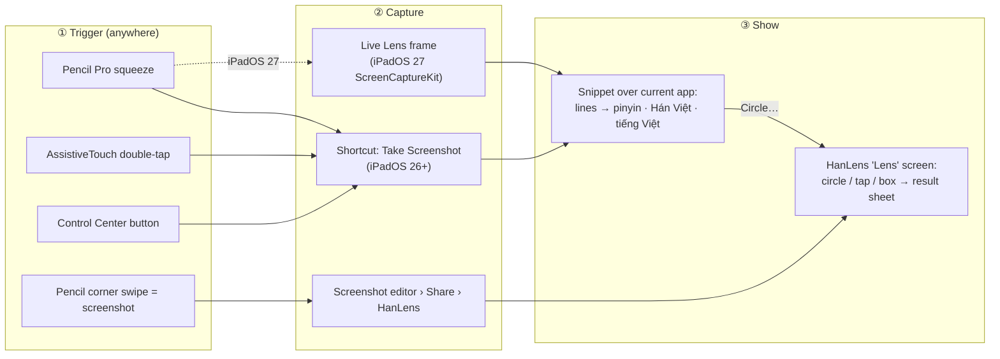

# HanLens on iPad — a "Circle to Search" flow for Chinese

*Brainstorm, October 2026 (iPadOS 26.x shipping, iPadOS 27 released 14 Sept 2026).*
Items marked **(verify)** come from documentation or reports but still need a test on a real iPad.

## The problem

On the Mac, HanLens works like Android's Circle to Search: a global hotkey freezes the screen, you circle the
text, a panel appears on top of whatever you're doing. iPadOS doesn't allow any of the three ingredients for
third-party apps:

| Mac ingredient | iPad reality |
|---|---|
| Global hotkey | No global hotkeys. System-wide triggers exist only through Shortcuts: **Apple Pencil Pro squeeze**, **AssistiveTouch**, **Control Center**, Spotlight, Siri, Full Keyboard Access. |
| Read the screen | Only via a **screenshot** the user takes, Shortcuts' *Take Screenshot*, **ScreenCaptureKit (new in iPadOS 27)** after the user starts a capture, or Visual Intelligence (iPadOS 27). |
| Panel over other apps | Only **App Intent snippets** (≤ ~400 pt, can have buttons since iPadOS 26), notifications, Picture-in-Picture — or opening our app (which in iPadOS 26's windowing/Stage Manager can be a window over the current one). |

The good news: everything that does the real work — Vision OCR, Apple's Chinese tokenizer, the SQLite dictionary,
Apple Translation (`TranslationSession(installedSource:target:)` works without UI on iPadOS 26), speech — is already
in **HanziKit**, which builds for iPadOS 26 unchanged. Even the circle-vs-rectangle gesture recognizer
(`SelectionGesture`) is shared.

## Recommended flows

### 1. "Squeeze to look" — the everyday flow (iPadOS 26+, ★ recommended first)

1. You're reading in any app. **Squeeze the Apple Pencil Pro** (or double-tap the AssistiveTouch button if you use a finger).
2. A one-time-installed shortcut runs **Take Screenshot → "HanLens: Look at Screen"** (an App Intent that takes an image).
3. Within a second a **snippet slides down over the current app** — you never leave it:
   - each Chinese line detected on screen as a row: 汉字 with pinyin above, Vietnamese below;
   - tap a row → it expands (interactive snippet): word-by-word pinyin + Hán Việt + meaning, 🔊 to hear it;
   - **Circle…** opens the full Lens screen (flow 2) with that screenshot when you need precision;
   - **Copy** / **Save to history**.
4. Swipe the snippet away — you're exactly where you were.

Why first: one physical gesture, no app switch, works on iPadOS 26 and every iPad with AssistiveTouch.
Costs: OCRs the whole screen, so on a crowded screen you pick the line from a list instead of circling it; snippets
are limited to roughly 340–400 pt (show ~4–6 lines, then "More in HanLens").

Setup the app should automate:
- An "Add to Shortcuts" button that opens a pre-built iCloud shortcut (an App Shortcut can't contain *Take Screenshot*,
  so the user installs one personal shortcut once).
- A guide screen: Settings › Apple Pencil › **Squeeze › Shortcut › "Look at Screen"** — or AssistiveTouch ›
  Custom Actions › Double-Tap. Squeeze can also run our own App Shortcut directly (no user shortcut needed) for
  flows that don't need a screenshot (flow 3).
- Gotchas **(verify)**: run from Control Center, the shortcut needs a ~0.4 s *Wait* before *Take Screenshot* so
  Control Center has closed; turn off Shortcuts banners (Screen Time › Notifications) so they don't appear in the capture.

### 2. "Screenshot, then circle" — precise selection (any iPad, no setup)

1. Take a screenshot the usual way — **Pencil swipe up from a bottom corner**, top button + volume up, or ⌘⇧3.
2. In the screenshot editor tap **Share › HanLens** (Action extension; also works from Photos, Files and any image).
3. HanLens' **Lens** sheet opens over the editor with the screenshot:
   - all Chinese lines are softly outlined after ~½ s (Vision, on device);
   - **circle or scribble** with Pencil/finger, **tap a line**, or drag a box — the same `SelectionGesture` as the Mac;
   - pinch to zoom for tiny text;
   - the result **bottom sheet** rises like Circle to Search: compact (translation + pinyin), medium (word list),
     large (word details, characters, examples).
4. Done → back in the screenshot editor → *Delete Screenshot* so Photos stays clean.

iPadOS 27 shortcut: the new Shortcuts **"Screenshot" automation trigger** fires when a screenshot is saved to
Photos, Files *or the Clipboard*. Recipe: Pencil corner swipe → crop by dragging the handles → **Copy & Delete** →
the automation passes the clipboard image to HanLens → snippet appears. Three quick gestures, exact region,
nothing saved **(verify that Copy & Delete fires the trigger)**.

### 3. "Live Lens" — no screenshots at all (iPadOS 27, power-user)

1. Once per session, tap **Start Live Lens** in HanLens → the system screen-sharing picker → *Entire Screen*.
   ScreenCaptureKit is new on iPadOS 27; with the `screen-capture` background mode the stream keeps running while
   you use other apps (the recording indicator stays visible).
2. Squeeze the Pencil (our **own App Shortcut**, no personal shortcut needed), tap our Control Center button, or
   use AssistiveTouch → the intent grabs the *latest frame* in-process and shows the same snippet as flow 1 — no
   screenshot animation, nothing in Photos.
3. **Subtitle mode**, the iPad version of the Mac's *Follow*: a Picture-in-Picture window that keeps showing the
   current subtitle line with pinyin + tiếng Việt while a video plays (precedent on the App Store: *PiP Screen Translate*).

Costs: iPadOS 27 only, battery, the recording indicator. App Review is strict about screen capture (2.5.14) and
background modes (2.5.4) — irrelevant for a personal build installed from Xcode or TestFlight.

### 4. Native Visual Intelligence — bonus (iPadOS 27)

On iPadOS 27, **Visual Intelligence** comes to iPads with M1 or later and the iPad mini (A17 Pro): take a screenshot,
**circle the text with the Pencil**, tap **Search**, pick **HanLens**. HanLens receives only the pixels of the
circled area (`SemanticContentDescriptor.pixelBuffer` via an `IntentValueQuery`), runs OCR and returns result cards
such as **学习 · xuéxí — học tập**; tapping one opens HanLens on that word.

It's the most "native" circle-to-search, but: it needs **Siri AI (beta)** turned on with the iPad in English
(not available in the EU or mainland China), results sit behind *Search* among other providers, and cards are
~3 lines. Cheap to add (one query + entity + `OpenIntent`), so worth shipping alongside flows 1–3.

### 5. Reading companions inside and around the app

- **Camera Lens** — `DataScannerViewController` with zh-Hans/zh-Hant for books, menus, signs: point, tap a word.
- **Share › HanLens for text** — select text in any app › Share › HanLens (text Action extension).
- **Safari Web Extension** — tap a word on any web page for a Zhongwen-style popup (pinyin, Hán Việt, tiếng Việt);
  no OCR needed. Safari-only; iOS requires a non-persistent background and per-site permission.
- **History + Anki export** synced with the Mac version through iCloud (later).
- Zero-install baseline to mention in onboarding: long-press text in any image (Live Text) › **Translate** — Apple
  Translate does Chinese → Vietnamese, but without pinyin, Hán Việt or a dictionary.

## Which trigger fits whom

| Trigger | Needs | One-time setup | Feel |
|---|---|---|---|
| **Pencil Pro squeeze** | Apple Pencil Pro (iPad Pro M4/M5, iPad Air M2+, iPad mini A17 Pro) | Settings › Apple Pencil › Squeeze › Shortcut | ★★★★★ closest to a hotkey |
| **AssistiveTouch double-tap** | Any iPad | Accessibility › Touch › AssistiveTouch › Custom Actions | ★★★★ always on screen |
| **Screenshot gesture** | Any iPad | None (Share › HanLens); iPadOS 27 automation optional | ★★★★ precise, a few more taps |
| **Control Center button** | iPadOS 18+ | Add Apple's *Shortcut* control (or ours for Live Lens) | ★★★ |
| **Keyboard** | Magic Keyboard | Full Keyboard Access › Commands (side effects: focus rings), or ⌘Space › "Look at Screen" | ★★ |
| **Visual Intelligence** | M1+ iPad, iPadOS 27, English, Siri AI beta | Turn on Siri AI | ★★★ native but more taps |

## Suggested build order

1. **iPad app shell on HanziKit** — Lens screen (image → circle/tap/box → bottom-sheet results), history, settings.
   The result views port from the Mac's SwiftUI almost directly.
2. **App Intent "Look at Screen"** (image in → interactive snippet out, plus *Open in Lens*), the iCloud shortcut,
   and the setup guide → flow 1.
3. **Action extensions** for images and text → flow 2.
4. **iPadOS 27**: ScreenCaptureKit Live Lens + PiP subtitles (flow 3), Visual Intelligence query (flow 4),
   Control Center control, Screenshot-automation recipe.
5. Camera Lens and the Safari extension.

## Open questions to test on a device

- Does *Take Screenshot* run from a Pencil squeeze or AssistiveTouch capture the app underneath cleanly (no
  "shortcut running" indicator in the image)?
- When the intent opens HanLens, does iPadOS show a "◀ previous app" breadcrumb? There is no API to return to the
  previous app; in windowed mode / Stage Manager HanLens opens as a window over it.
- Snippet sizing in the Shortcuts presentation vs Siri (reported differences on iOS 27.1).
- Does *Copy & Delete* in the screenshot editor fire the iPadOS 27 Screenshot automation?
- Memory and battery cost of a full-display ScreenCaptureKit stream on iPad.

## Sources

- Visual Intelligence on iPad (iPadOS 27): [Apple — Use visual intelligence on iPad](https://support.apple.com/guide/ipad/iphmk4p88mkuky/ipados) ·
  [MacRumors — iPadOS 27 hands-on](https://www.macrumors.com/2026/06/17/ipados-27-hands-on/) ·
  [Apple feature availability](https://www.apple.com/ios/feature-availability/)
- Visual Intelligence API: [Integrating your app with visual intelligence](https://developer.apple.com/documentation/visualintelligence/integrating-your-app-with-visual-intelligence) ·
  [WWDC25 session 275](https://developer.apple.com/videos/play/wwdc2025/275/) · [WWDC26 session 297](https://developer.apple.com/videos/play/wwdc2026/297/)
- Apple Pencil squeeze → shortcuts: [Apple Shortcuts guide](https://support.apple.com/guide/shortcuts/apdbe445a3a2/ios) ·
  [Handling squeezes from Apple Pencil](https://developer.apple.com/documentation/applepencil/handling-squeezes-from-apple-pencil)
- Snippets: [WWDC25 session 281](https://developer.apple.com/videos/play/wwdc2025/281) ·
  [HIG — Snippets](https://developer.apple.com/design/human-interface-guidelines/snippets) ·
  [Displaying static and interactive snippets](https://developer.apple.com/documentation/appintents/displaying-static-and-interactive-snippets)
- Controls: [Creating controls to perform actions across the system](https://developer.apple.com/documentation/widgetkit/creating-controls-to-perform-actions-across-the-system)
- ScreenCaptureKit on iPadOS 27: [Capturing screen content on iOS](https://developer.apple.com/documentation/screencapturekit/capturing-screen-content-on-ios)
- Shortcuts in iPadOS 27 (Screenshot trigger): [Apple — event triggers](https://support.apple.com/guide/shortcuts/event-triggers-apd932ff833f/ios) ·
  [9to5Mac — iOS 27 Shortcuts](https://9to5mac.com/2026/09/29/ios-27s-shortcuts-app-adds-35-new-improved-actions-heres-whats-new/)
- Windowing / Slide Over: [WWDC25 session 282](https://developer.apple.com/videos/play/wwdc2025/282) ·
  [MacStories on Slide Over](https://www.macstories.net/linked/reports-of-slide-overs-death-were-greatly-exaggerated/)
- Live Text translate: [Apple — Live Text](https://support.apple.com/en-us/120004)
- DataScanner: [DataScannerViewController.isSupported](https://developer.apple.com/documentation/visionkit/datascannerviewcontroller/issupported)
