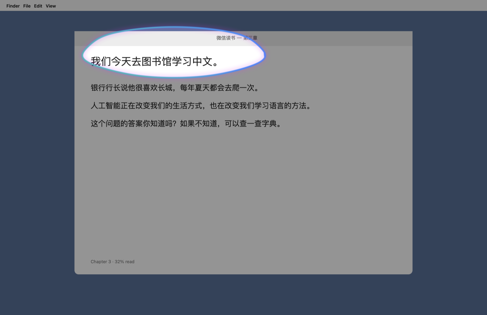
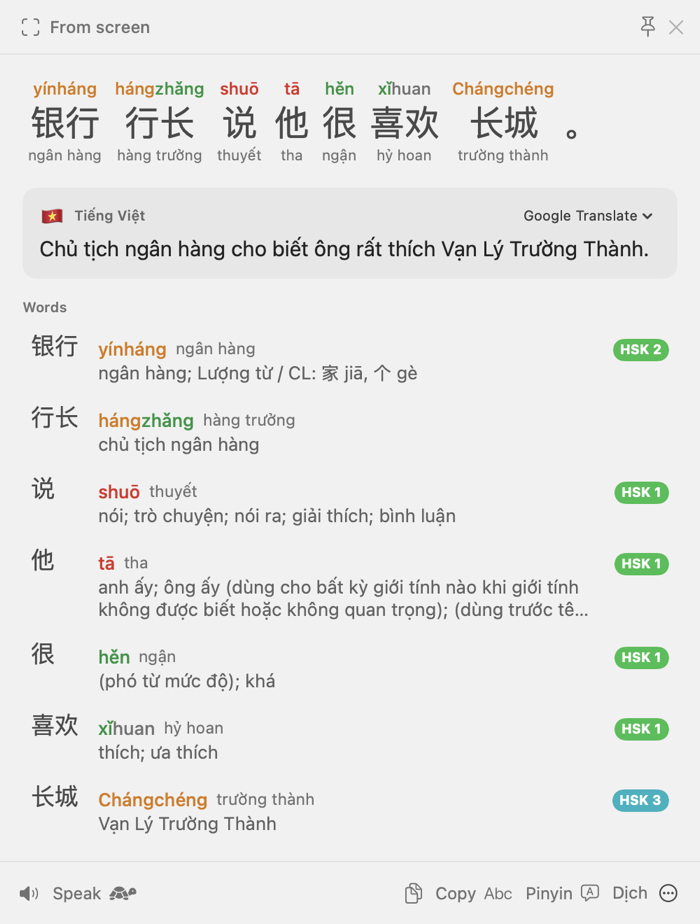

# HanLens for macOS 🔎文

Circle any Chinese text on your Mac — in a video, an image, a PDF, a game, a chat — and get **pinyin, Hán Việt,
a Vietnamese translation, word-by-word meanings and example sentences** in a floating panel.
It is the macOS version of the Windows *Pinyin Input & Chinese Dictionary* app in this repository, rebuilt as a
native Swift app.

<p align="center">
  
</p>
<p align="center">
  
  
</p>

## What's better than the Windows version

| | Windows version | HanLens (macOS) |
|---|---|---|
| Selecting text | Drag a rectangle | Drag a rectangle **or circle/scribble** (Circle to Search style), **or click a detected line** — every Chinese line on screen is detected while you aim |
| OCR | Windows OCR | Apple Vision (simplified + traditional + Cantonese), automatic upscaling for tiny text, smart joining of wrapped lines |
| Readings | pypinyin per character | Context-aware readings: word context (银行 *yínháng* / 行长 *hángzhǎng*) plus grammar for lone polyphones (还 *hái*/*huán*, 得 *de*/*dé*/*děi*, 长 *zhǎng*/*cháng*, 一只 *zhī*…), neutral tones and erhua from the dictionary |
| Hán Việt | — | Reading-correct Hán Việt for every word (银行 → *ngân hàng*, 图书馆 → *đồ thư quán*), with native Nôm readings filtered out using Thiều Chửu's dictionary (喝 → *hát*, not *húp*) |
| Word meanings | Google-translates "w1 \| w2 \| w3" and splits on "\|" | Offline Vietnamese dictionary (CVDICT, ~122k entries) + English (CC-CEDICT), HSK level, per-character breakdown, grammar-wiki links |
| Examples | — | 65k Tatoeba example sentences with pinyin, Vietnamese (human or machine) / English |
| Translation | Google (deep_translator — its scraping endpoint no longer returns results) | Google Translate, or Apple's **offline, on-device** engine; automatic fallback between them |
| Video subtitles | — | **Follow** mode: keeps reading the same area and updates as subtitles change |
| Speech | SAPI / sherpa-onnx | Studio-quality Mandarin from **Microsoft Azure** (Xiaoxiao 晓晓, Yunxi 云希… — free tier) or **ElevenLabs**, with the free Google voice and the best Apple voice as automatic fallbacks (never the robotic legacy voices); slow mode; karaoke highlight of the word being read |
| Selected-text translate | Simulates Ctrl+C (clobbers the clipboard) | Accessibility API first (clipboard untouched), ⌘C fallback restores your clipboard; plus a **Services menu** item that needs no permission |
| Pinyin tone typing | `ma1 → mā` | Same, plus re-toning (`mā` + `3` → `mǎ`), stays out of the way of the Pinyin/Vietnamese input methods, and ignores ordinary words like `chapter1` |
| History | — | Searchable history, export to Anki |
| Focus | Popups steal focus | Panels never steal focus from the app you're reading; drag a panel to pin it |

## Install

**Download:** get `HanLens-<version>.dmg` from [Releases](https://github.com/an6122003/chinese-ocr-translate/releases/latest),
open it and drag HanLens to Applications. It isn't notarized, so the first time macOS refuses to open it: click
**Done**, then System Settings › Privacy & Security › **Open Anyway**. Needs macOS 26 (Tahoe) or later.

**Build from source** — requirements: macOS 26 (Tahoe) or later, Xcode 26, XcodeGen (`brew install xcodegen`), Python 3.

```bash
cd macos
make install
```

This downloads the pinned dictionary sources (≈ 25 MB, checksum-verified), builds the dictionary, builds the app,
signs it with your first *Apple Development* certificate (a stable signature means macOS remembers the permissions
across rebuilds), copies it to `/Applications` and launches it.

Other targets: `make` (build only, into `build/`), `make test`, `make project` (generate `HanLens.xcodeproj` to work in
Xcode — set your team in the project if it isn't `QUV7VD99GR`), `make dmg` (a shareable `build/HanLens-<version>.dmg`),
`make clean`.

## First run

HanLens lives in the Dock and the menu bar (文) — right-click the Dock icon for its actions, or turn the Dock icon off
in Settings › General. The welcome window walks you through two permissions:

1. **Screen Recording** — required to read text on screen. Click **Grant…**, switch HanLens on in System Settings, then
   click **Relaunch** (macOS applies the permission after a restart). Nothing is recorded or uploaded; macOS may
   occasionally remind you that HanLens can capture the screen.
2. **Accessibility** — optional; lets ⌃⌥X read the selected text and powers pinyin tone typing.

## Using it

| Action | How |
|---|---|
| **OCR — any text on screen, even non-selectable** (images, videos, PDFs, games) | **⌃⌥S** (menu bar 文 › **OCR Capture**) — the screen freezes. Drag a box, circle/scribble around text, or click a highlighted line. ↩ reads the whole screen, esc cancels. Press ⌃⌥S again to cancel. Needs the Screen Recording permission. |
| **Translate selected text** | Select text in any app, press **⌃⌥X** — or right-click › **Services › Look Up in HanLens** (no permission needed; you can give it a shortcut in System Settings › Keyboard › Keyboard Shortcuts › Services). |
| **Look up by typing** | Menu bar › **Look Up…** (assign a shortcut in Settings) — type or paste, ⌘↩. |
| **In the result panel** | **Space** read aloud · 🐢 slowly · click a word for details · **← →** move between words · **⌘E** edit/fix the text · **⇧⌘C** copy · **⌘F** follow · **esc** close. Drag the panel to pin it; widen it by dragging its edge. |
| **Follow subtitles** | Capture a subtitle line, then **Follow** (⌘F): the panel keeps reading that area and updates when the line changes. |
| **Type pinyin tones** | Turn on in the menu (or Settings › Pinyin Typing), then type `ni3hao3` → `nǐhǎo`, `lv4` → `lǜ`. Works with the ABC layout; pauses automatically while an input method is active. |
| **History** | Menu bar › **History** — search by Chinese, pinyin or meaning; double-click to look up again; export to Anki. |
| **Automation** | `open "hanlens://capture"`, `hanlens://selection`, `hanlens://clipboard`, `hanlens://lookup?text=学习` (e.g. from Raycast, Alfred or Shortcuts). |

Shortcuts are configurable in **Settings › Shortcuts**. The defaults add ⌃ to the Windows ones because Option-only
global shortcuts were blocked in macOS 15.0–15.1 and are still reported unreliable.

## Settings worth knowing

- **Translation**: target language (Tiếng Việt / English), engine (Google — best quality; Apple — private and works
  offline after a one-time model download, offered right there), Hán Việt / pinyin / tone colours / English toggles.
- **Speech**: the voice service, voice and speed (`open hanlens://settings/speech` jumps straight there).
  - *Microsoft Azure* (default, recommended): the zh-CN neural voices used across Chinese apps and videos. Create a
    **Speech** resource with the **Free F0** tier in the [Azure portal](https://portal.azure.com/#create/Microsoft.CognitiveServicesSpeechServices)
    (500,000 characters a month; F0 never bills — when it runs out, HanLens falls back to Google until the next month),
    copy **KEY 1** from *Keys and Endpoint* and paste it here. The region is detected automatically.
  - *ElevenLabs*: **Sign in with ElevenLabs** (opens elevenlabs.io in your browser — no API key needed) or paste an
    API key, then pick a native Mandarin voice from the voice library. Uses your plan's credits (about 1 per
    character; Flash v2.5 half that); the account row shows how many are left this month.
  - *Google (free)*: no setup, but the voice sounds dated. Used automatically whenever a cloud voice fails.
  - *Apple (offline)*: for a natural offline voice, download a Chinese *Premium* or *Enhanced* voice in System
    Settings › Accessibility › Spoken Content › System Voice › Manage Voices.

  Keys and the ElevenLabs sign-in are stored in the login Keychain. The text being read is sent to the selected
  service; replays come from a cache.
- **General**: open at login, show in the Dock, auto-copy recognized text, read aloud automatically, keep history.

## Troubleshooting

- **The screen freezes but nothing is recognized / "Couldn't capture the screen"** — Screen Recording isn't active yet:
  System Settings › Privacy & Security › Screen & System Audio Recording › HanLens on, then relaunch HanLens.
- **⌃⌥X says to select text first** — some apps don't expose selections; HanLens falls back to ⌘C, which needs the
  Accessibility permission. The Services menu item always works.
- **"Look Up in HanLens" isn't in the Services menu** — run `/System/Library/CoreServices/pbs -update` or log out and in.
- **A shortcut doesn't work** — Settings › Shortcuts shows a warning when macOS refuses a combination (another app
  owns it); record a different one.
- **Logs**: `log stream --predicate 'subsystem == "com.nguyenan.HanLens"' --level debug`

## How it's built

```
macos/
├── HanziKit/            Swift package shared with a future iPad app (no AppKit):
│   ├── Pinyin/          tone marks, CC-CEDICT pinyin, tone-typing logic
│   ├── Dictionary/      SQLite dictionary, definitions, examples
│   ├── Analysis/        segmentation (Apple NLTokenizer + dictionary) and context-aware readings
│   ├── OCR/             Vision text recognition and line joining
│   ├── Translation/     Google + Apple Translation with fallback
│   ├── Speech/          Azure / ElevenLabs / Google / Apple voices with word highlighting
│   └── Selection/       rectangle-vs-circle gesture recognition
├── HanLens/Sources/     the macOS app: menu bar, hotkeys (Carbon, no permission), ScreenCaptureKit capture,
│                        overlay, floating panels (SwiftUI), tone typing (event tap), settings, history
├── Data/                sources.lock.json (pinned URLs + SHA-256), vendor/ (CVDICT, Hán Việt list, Tatoeba subset),
│                        LICENSES.md; build output hanzi.sqlite and cache/ are git-ignored
├── oauth/               elevenlabs-client.json — the public OAuth client document for “Sign in with ElevenLabs”.
│                        Its jsDelivr URL (…/chinese-ocr-translate@main/macos/oauth/elevenlabs-client.json) is
│                        HanLens's client ID, so keep it at this path on main.
└── scripts/             fetch_sources.py, build_dictionary.py, update_tatoeba.py, make_app_icon.swift (writes
                         HanLens/Resources/AppIcon.icon, the layered Liquid Glass app icon: magnifier over 汉)
```

- `make test` runs 68 unit tests: pinyin rules (including every case from the Windows `pinyin_logic.py`), tone
  typing, OCR on rendered Chinese (simplified, traditional, tiny 12 px text), segmentation and readings against the
  real dictionary, grammar-based polyphone readings, keystroke-level tone typing, gesture recognition,
  translation response parsing, cloud-voice errors, and ElevenLabs sign-in (PKCE, redirect checks, token refresh,
  the loopback receiver on 127.0.0.1/::1).
- Rebuild the dictionary after changing the pipeline: `make data`. Refresh example sentences from Tatoeba's weekly
  export: `python3 -I scripts/update_tatoeba.py && make data`.
- Preview UI without permissions: `build/HanLens.app/Contents/MacOS/HanLens --render-panel "学习中文" /tmp/panel.png [--dark] [--select 0]`
  or `--render-overlay screenshot.png /tmp/overlay.png --preview lasso`.

## Data & licences

The offline dictionary combines CVDICT (Phong Phan, CC BY-SA 4.0), CC-CEDICT (MDBG, CC BY-SA 4.0), the Hán Việt
word list (Phong Phan, MIT), Unihan (Unicode License v3), Tatoeba sentences (CC BY 2.0 FR), the HSK 3.0 list (MIT)
jieba frequencies (MIT) and Thiều Chửu's *Hán Việt tự điển* (public domain). The built database is therefore CC BY-SA 4.0. Full credits and licence texts:
[`Data/LICENSES.md`](Data/LICENSES.md) (also bundled in the app: Settings › About › Licences).

The CC-CEDICT copy and grammar keywords come from the [Zhongwen](https://github.com/cschiller/zhongwen) extension;
its repository was audited before use (no remote code, no data collection, vendored libraries byte-identical to
upstream releases).
